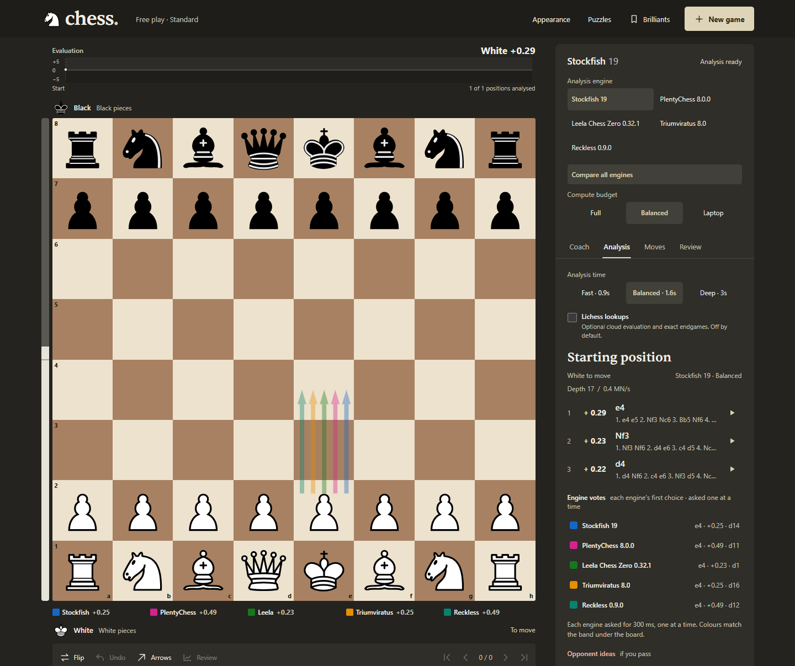
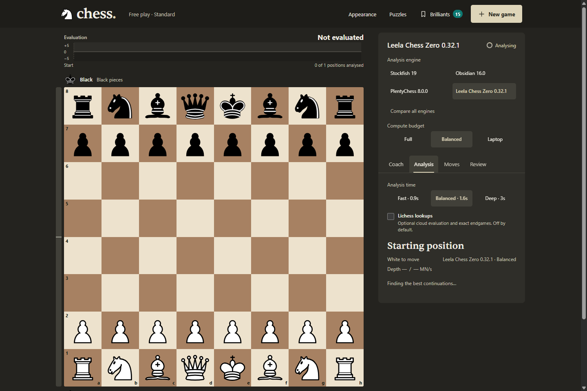

# Chess Play & Fun

**Compare five engines on the same board. Understand your next move.**

A local chess workbench for Windows. Play Standard or Chess960, watch candidate moves appear as the engine searches, and review your mistakes with explanations and retry drills. The engines run on your computer; optional Lichess lookups stay off until you enable them.

[](https://github.com/Ekka-Barber/Chess-Play-Fun/actions/workflows/ci.yml)


[](LICENSE)



[Install](#run-locally) · [Use the board](#use-the-board) · [Engine guide](#choose-your-engine) · [Performance](#measured-performance) · [Changelog](CHANGELOG.md) · [Releases](https://github.com/Ekka-Barber/Chess-Play-Fun/releases)

## Latest: v4.0.2

- Smaller hollow legal-move markers replace the heavy filled dots. Capture rings leave the pieces visible.
- A softer evaluation rail includes an equality midpoint, a quicker transition, and a labelled score above the board. Unknown evaluations and retry drills no longer display a misleading even position.
- Five-engine arrows use lower opacity, including their hover state, so the board stays readable when engines agree.
- Candidate moves stream before grading finishes. Free-play engine replies no longer wait through an artificial pause.
- Lichess cloud requests use the documented `multiPv` parameter. Online lookups remain optional and cached.

Verified with **116 passing tests**, desktop and phone browser checks, board flipping, and evaluation states for equal positions, advantages, mate, unknown scores, and retries. [See the updated board](assets/screens/app-board-controls.png) or [read the release notes](CHANGELOG.md).

## Run locally

Use Windows x64 and a CPU with AVX2/BMI2 support for the supplied engine builds. Node.js 24 was used for the local audit. Node 20.x from 20.19 and Node 22.x from 22.12 also provide the [synchronous ESM loading](https://nodejs.org/api/modules.html#loading-ecmascript-modules-using-require) this app uses.

```powershell
git clone https://github.com/Ekka-Barber/Chess-Play-Fun.git
cd Chess-Play-Fun
npm ci
npm run setup:engines
npm start
```

Open **[localhost:4655](http://localhost:4655/)**. Keep the terminal open while playing; press `Ctrl+C` to stop the server.

`setup:engines` downloads pinned official releases and the required network file. Run it once, or again to repair missing files; it skips files already present at the expected minimum size. Engine binaries are not included in the repository.

After setup, you can also double-click **`START-CHESS.bat`**. The launcher installs missing Node dependencies and starts the app. Engine downloads remain a separate setup step.

**Save before stopping:** the live game stays in server memory. Export its PGN before restarting. Saved Brilliant-move collections are written to disk.

<details>
<summary>Something did not start?</summary>

| Symptom | What to do |
| --- | --- |
| `node` or `npm` is not recognised | Install a supported Node.js version, reopen the terminal, then retry. |
| Engine download fails | Run `npm run setup:engines` again. Download URLs and target paths are in [the setup script](scripts/setup-engines.js). |
| Only Stockfish appears | The registry skips executables missing from disk. Complete the engine setup, then restart the server. |
| An engine cannot launch on this CPU | Use an upstream build compatible with your instruction set and update its path in [engines.json](engines.json). |
| Engine becomes unavailable during play | Use **Retry engine**. If it fails again, check the executable and restart the server after exporting your PGN. |
| Port 4655 is already occupied | Use the running instance, or set another port: `$env:PORT=4660; npm start`. |
| An old Node version reports an ESM loading error | Use Node.js 24, or the supported 20.x/22.x versions listed above. |

</details>

## Use the board

### Play at your level

Open **New game** to choose Standard or Chess960, your side, an optional clock, and a playing mode.

- **Play both sides.** Move freely to study a position. You can hand White or Black to the selected engine.
- **Play against an engine.** Strength steps from 10% to 90% use Stockfish's Elo limiter, covering 1320 to 2800. At 100%, the engine has no rating cap; search time is still bounded.
- **Try different replies.** Optional **Random top-5** chooses among leading candidates. Forced mates take priority. If the engine's evaluation falls to -3 pawns or worse, survival mode selects its best move until it recovers above -1.5.

Engine moves commit when the search finishes. There is no extra random pause afterward.

Clocks are optional: 3+2, 5+0, 10+0, or custom minutes and Fischer increment. A takeback restores the clock snapshot for that position. Clocks belong to the current tab and disappear on reload.

### Ask one engine, or compare all five

The **Arrows** button cycles through **Off → Best → Engines**.

| Mode | What appears |
| --- | --- |
| **Best** | Three candidate moves in a green ranking: stronger lines are darker and wider. Slim red arrows show the opponent's ideas if you pass. |
| **Engines** | Each installed engine's first choice in its own colour. Agreeing engines occupy separate lanes instead of covering one another. The band below the board identifies each engine and evaluation. |

You can enter comparison mode directly from **Engine → All five · engine votes**. Open the **Analysis** tab for each engine's move, evaluation, and depth. Hover or focus a row to isolate its arrow.

Comparison requests use a 300 ms budget per engine and search one engine at a time. Initialization can overlap. A playing engine's reply gets priority over analysis work.

<details>
<summary>See ranked analysis without the engine-vote overlay</summary>



</details>

### Learn from the moves you played

The **Coach** grades moves from Brilliant and Great through Inaccuracy, Mistake, and Blunder. It explains the assessment, shows the better continuation, and identifies the opening when the move sequence is in the built-in book.

Open **Review** for side-by-side accuracy, the winning-chances graph, and key moments. **Retry** returns you to a mistake and judges an alternative without changing the game. An answer passes if it is the best move, delivers mate, or stays within five percentage points of the best move's expected outcome.

**Deep review** uses a separate engine process with a depth-20 target and a 20-second cap per position. You can browse the board while it runs. Move labels use this app's own grading heuristics and can change as analysis deepens.

### Keep your Brilliant moves

A verified player sacrifice classified as Brilliant is automatically saved under `Brilliant Moves/` with:

- A 1024 × 1240 board image.
- The game PGN.
- Metadata, the explanation, and the position before the move.

Open **Brilliants** to download an image or PGN, or use **Study** to restore the saved game. Engine moves are not collected as the player's finds.

## Choose your engine

The registry records the installed binaries' capabilities. The selected engine handles the roles it supports; the UI explains any Stockfish fallback.

| Engine | Chess960 | Multiple candidate lines | Elo limiter | Role in this app |
| --- | :---: | :---: | :---: | --- |
| [Stockfish 19](https://github.com/official-stockfish/Stockfish) | Yes | Yes | Yes | Default engine; calibrated opponents and fallback coaching. |
| [Berserk 14](https://github.com/jhonnold/berserk) | Yes | Yes | No | Full-strength play, analysis, and comparison votes. |
| [Obsidian 16.0](https://github.com/gab8192/Obsidian) | No | Yes | No | Standard-chess play, analysis, and comparison votes. |
| [PlentyChess 8.0.0](https://github.com/Yoshie2000/PlentyChess) | Yes | Yes | No | Standard and Chess960 play, analysis, and comparison votes. |
| [Viridithas 20.0.0](https://github.com/cosmobobak/viridithas) | Yes | No | No | Full-strength play and its own single-line comparison vote. |

**Fallbacks to expect:**

- At 10-90% strength, Stockfish plays if the chosen engine has no Elo limiter.
- In Chess960, Stockfish handles Obsidian's playing and analysis roles. Comparison mode marks Obsidian as unsupported rather than inventing an Obsidian vote.
- Viridithas plays its own moves, but Stockfish supplies the multiple lines needed for coaching, grading, and threats.

Release tags are pinned in [the setup script](scripts/setup-engines.js): `sf_19`, `14`, `v16.0`, `b-v8.0.0`, and `v20.0.0`. Paths and capability flags live in [engines.json](engines.json).

## Measured performance

The November 2026 audit measured these paths before and after the responsiveness fixes:

| Task | Before | After |
| --- | ---: | ---: |
| Completed next-position analysis after two rapid off-book moves | 3.22 s | 1.61-1.63 s |
| Five-engine comparison with newly started engine processes | 2.60 s | 1.59-1.70 s |
| Browser update interval while work is active | 700 ms | 200 ms |

These are local measurements in Balanced mode with two engine threads. Position, CPU load, startup state, and engine caches affect timing. They are not promises for every machine.

Suggestions now stream during search, before historical grading completes. An early preview can be shallow; only completed searches enter the cache used for grading, hints, and retry judging. The configured search budgets and rating limits were preserved.

[Read the full audit](AUDIT-V4.md) for the measurement conditions, individual engine timings, regression cases, and verification limits.

### Keep chess work within a budget

Live analysis, engine votes, and playing replies share **one interactive search slot**. Game replies get priority. Deep review has its own process and lower scheduling priority.

| Power mode | Analysis threads | Playing threads | Deep-review threads | Deep-review priority |
| --- | ---: | ---: | ---: | --- |
| Full | 3 | 2 | 3 | Below normal |
| Balanced, default | 2 | 2 | 2 | Idle |
| Laptop | 1 | 1 | 1 | Idle |

Analysis and playing thread counts are alternate users of the shared slot, not concurrent interactive searches. The comparison engines use the analysis budget.

Idle engines quit after five minutes and restart on demand. Live analysis pauses when every tracked tab is hidden; a visible tab keeps it active. Existing polls renew tab visibility, and closed or expired tabs do not keep a visible board paused. Playing replies and deep review continue independently of that visibility pause.

## Optional online lookups

In **Analysis → Online**, choose **On** to enable two Lichess services for positions in the current game:

| Service | What it provides | Local cache |
| --- | --- | --- |
| Tablebase | Exact endgame results for positions with seven pieces or fewer, including DTZ/DTM when available. | Stored without expiry. |
| Cloud evaluation | A stored evaluation and principal variation for the current position, when Lichess has one. | 24 hours. |

The server checks that a requested FEN belongs to the game before sending it upstream. Tablebase piece counting happens locally. Cache files live under `.cache/online/`, and upstream failures return a readable status in the app.

With Online off, play and local analysis work without those services. Initial dependency and engine downloads still require an internet connection.

## Controls

Use drag and drop, click a piece then its destination, or navigate by keyboard. Selecting a piece shows legal destinations. In Chess960, castle by moving the king onto its rook.

| Key | Action |
| --- | --- |
| Arrow keys while the board has focus | Move between squares. |
| `Enter` / `Space` | Select a piece or play to the focused destination. |
| `Esc` | Cancel selection. |
| `←` / `→` outside the board | Browse previous/next positions. |
| `Home` / `End` | First/latest position. |
| `F` | Flip the board. |

The app includes six board themes, labelled board squares, visible focus states, reduced-motion support, and a mobile layout. Theme choice is remembered in your browser.

## Know the limits

- **One shared game per server process.** Tabs share the board and session settings. The app is a local workbench, not a multiplayer server.
- **Live games are not persisted.** Restarting clears the current game. Export PGN before stopping; saved Brilliant collections remain on disk.
- **Clocks are tab-local.** Reloading loses the current clock, even while the server's game continues.
- **Windows engine setup.** Other operating systems and instruction sets need compatible upstream binaries and configuration. They are not packaged by the setup script.
- **Time-bounded judgments.** A depth target may hit its time cap, and deeper analysis can change a move's grade.
- **PGN export is available; PGN import is not implemented.** Online opponent play and automatic game imports are also outside the current app.
- **Accessibility checks have limits.** Automated checks and keyboard testing ran in Chromium; a full screen-reader and physical-touch audit has not been completed.

## Development and verification

Vanilla JavaScript, Express, [chessops](https://github.com/niklasf/chessops), and native UCI processes. No frontend build step.

```powershell
npm ci
npm test
```

The local audit passed **116 tests**. Tests stub the engine boundary and run without downloading the binaries; the alternate-engine switch case skips when no second engine is installed. [GitHub Actions](https://github.com/Ekka-Barber/Chess-Play-Fun/actions/workflows/ci.yml) runs the suite on Node 20 and 22.

Coverage includes legal moves and Chess960 castling, stale requests, engine fallback and switching, progressive analysis, exclusive search scheduling, tab visibility, clocks, move grading, retry judging, archive writes, online opt-in, arrow geometry, and contrast rules.

Separate browser checks exercised all five engines at 100% strength, engine-vote cycling, history controls, and six themes at desktop and narrow widths. The audit recorded zero automated Axe violations in the checked state. That result is not an accessibility certification.

### Find the code

| Path | Responsibility |
| --- | --- |
| [server.js](server.js) | Game state, routes, analysis scheduling, engine comparison, and review. |
| [lib/engine.js](lib/engine.js) | UCI transport, progressive results, process lifecycle, and priority. |
| [lib/governor.js](lib/governor.js) | Power budgets and the shared interactive search slot. |
| [lib/rules.js](lib/rules.js) | Legal moves, SAN, PGN, and Chess960 through chessops. |
| [lib/tutor.js](lib/tutor.js) | Move grading, hints, and sacrifice assessment. |
| [lib/archive.js](lib/archive.js) | Brilliant-move images, PGN, metadata, and collection storage. |
| [lib/online.js](lib/online.js) | Opt-in Lichess requests and disk caching. |
| [public/](public/) | Board UI, themes, clocks, review tools, and piece assets. |
| [scripts/](scripts/) | Engine setup and screenshot capture tools. |
| [test/](test/) | Regression suite. |

For a bug report, include the selected engine, variant, power mode, Node version, and the move sequence or exported PGN. [Open an issue](https://github.com/Ekka-Barber/Chess-Play-Fun/issues).

## Credits and licenses

The application code uses the [MIT license](LICENSE). Downloaded engines have their own upstream licenses; review the projects linked in the engine table before redistributing binaries.

The app uses [chessops](https://github.com/niklasf/chessops), [Express](https://expressjs.com/), [resvg-js](https://github.com/yisibl/resvg-js), the [Cburnett chess pieces](public/pieces/LICENSE.txt), and the self-hosted [Sentient typeface](public/fonts/LICENSE.txt). Its accuracy calculations follow the published Lichess approach; its move classifications are local heuristics.

README screenshots show the running application with real engine results. Optional poster artwork in `assets/` was generated with GPT Image 2.5 via Higgsfield and is separate from the app interface.
