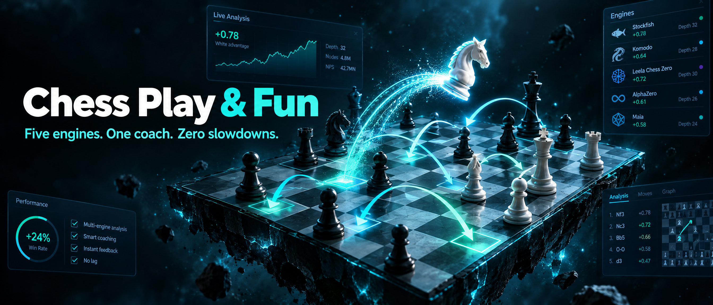
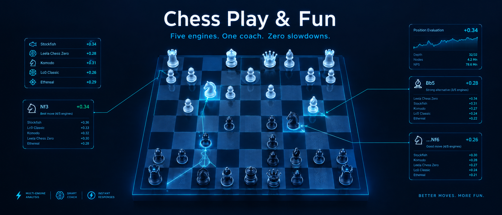
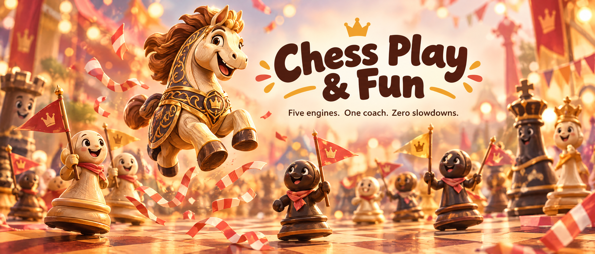
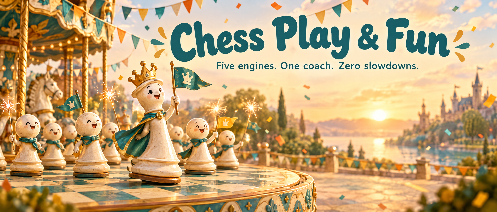

<p align="center">
  
</p>

<h1 align="center">♟ Chess Play &amp; Fun</h1>

<p align="center"><em>Five engines. One coach. Zero slowdowns.</em><br>
A local chess workspace that respects your laptop.</p>

<p align="center">
  <a href="https://github.com/Ekka-Barber/Chess-Play-Fun/stargazers"></a>
  <a href="https://github.com/Ekka-Barber/Chess-Play-Fun/network/members"></a>
  <a href="https://github.com/Ekka-Barber/Chess-Play-Fun/issues"></a>
  <a href="LICENSE"></a>
  <a href="https://github.com/Ekka-Barber/Chess-Play-Fun/actions/workflows/ci.yml"></a>
  <a href="https://github.com/Ekka-Barber/Chess-Play-Fun/commits"></a>
</p>

<p align="center">
  
  
  
  
  
  
  
  
  
  
</p>

---

> **No account. No cloud. No telemetry. No frozen cursor.**
> Standard chess and Chess960, a coach that grades every move, five world-class engines — all in your browser against a local Node process that **budgets chess work like a good citizen**.

## ♞ The 60-second tour

| You want to… | You get |
|---|---|
| **Play** | Ten calibrated strength steps (1320–2800 Elo, unlimited at 100%) — or hand a side to any of five engines that answers after a human-like pause |
| **Watch the clock** | Optional — 3+2, 5+0, 10+0 or custom (1–180 min · Fischer increment); lives in this tab only (a reload drops it), and a takeback rewinds it to the exact snapshot |
| **Spice it up** | **Random top-5** mode: the engine picks from its best ideas at random, with a *survival mode* that snaps to full strength when it gets into trouble |
| **Improve** | Every move graded `Brilliant !!` → `Blunder ??` with a plain-language explanation, the refutation, and the better move |
| **See the ideas** | Ranked arrows on the board, the reference-site way: one vivid green at three translucencies — near-solid for the best move down to a breath for rank 3 — plus slim red threats, all fat, all translucent, so the live board stays visible under the annotation |
| **Compare the engines** | Pick **⟐ All five · engine votes** in the top-bar Engine menu (or cycle the Arrows button): every registered engine casts one coloured first-choice arrow — five opinions on one board, asked strictly one at a time — with an always-on **colour band under the board** naming each engine's colour and eval, plus a hoverable detail legend |
| **Review** | Lichess-formula accuracy, a clickable winning-chances graph, key moments — and **Retry**: the board rewinds to your mistake and you must find the right move, judged to within 5% winning chances |
| **Collect** | Every brilliant move auto-saved as a shareable 1024×1240 board image + PGN + metadata, in a restorable gallery |
| **Be different** | Six board themes, drag & drop, click-to-move, full keyboard play, Chess960 (positions 0–959) |

## 📸 The app, for real

| Ranked best-line arrows — the translucent ladder | Engine votes — five engines, five colours, one band |
|---|---|
|  |  |

Both captured from the running app (`scripts/capture-screens.mjs`) — arrows and legends are the real UI, not mock-ups.

## 🆕 What's new

**v4.0.1 — Arrows like the big boards**
- All board arrows rebuilt to the reference sites' actual recipe (read from chessground's shipped brush table and chess.com's game-review overlays): **saturated mid-tone colours drawn translucent with fat, head-scaled shafts** — the live board stays fully visible under the annotation, on every theme
- Best-line suggestions: one vivid green at three transparencies and widths — near-solid best move down to a breath-light rank 3 (**darker = stronger**) — plus slim red threats
- **Engine votes, discoverable**: the top-bar Engine menu now leads with **⟐ All five · engine votes**, and an always-on **colour band under the board** names each engine's colour with its live eval
- Engines that agree on a move draw staggered parallel arrows (sideways *and* by length), guaranteed inside the board; a new colour-law test pins the vivid profile so a regression to unreadable dark tints fails CI

**v4.0.0 — Five engines, one coach**
- The **Engines coach view**: every registered engine asked strictly one at a time (300 ms each, through the governor's single slot) casts its first-choice arrow — five opinions on one board
- Fixed the broken fresh-install download (Stockfish now pinned to the sf_19 zip and unpacked automatically), hardened multi-tab pause and game-restore, added **CI on GitHub Actions** (107 engineless tests, Node 20/22), and replaced poster-only marketing with real screenshots

## 🏆 The engine roster

Five engines ship in the registry — and every one's **real capabilities were probed from the binary**, not copied from a README. Your pick is used wherever it qualifies; Stockfish fills any gap and the UI tells you when it does.

| Engine | Elo limit | Chess960 | MultiPV | Analyses | Signature |
|---|:-:|:-:|:-:|:-:|---|
| **Stockfish 19** *(default)* | 1320–2800 | ✅ | ✅ | ✅ | The calibrated all-rounder |
| **Berserk 14** | — | ✅ | ✅ | ✅ | TCEC-grade attacker |
| **Obsidian 16.0** | — | ❌ | ✅ | standard only | Top-3 bullet monster, trained on Leela data |
| **PlentyChess 8.0.0** | — | ✅ | ✅ | ✅ | Trained on 15B positions incl. Fischer Random — **the Chess960 specialist** |
| **Viridithas 20.0.0** | — | ✅ | — | ❌ | Plays at full strength; single-line eval |

So: pick **PlentyChess** for a Fischer-Random game. Pick **Obsidian** for a second opinion from a completely different evaluation lineage. Play any of them at full strength — at 10–90%, the Elo-calibrated Stockfish takes the seat, because none of the others ship a rating limiter.

## 🛡️ The resource governor

Most analysis boards assume a workstation. This one was designed on — and measured against — a thin 2P+8E laptop, so it **never pins your machine**:

```
        ┌─────────────────────────────────────────────┐
        │  GOVERNOR — max ONE interactive search      │
        │  a game reply always jumps the queue        │
        └─────────────────────────────────────────────┘
   analysis engine ◄──shared slot──► playing engine
   deep review ─ outside the slot, thread-capped, IDLE priority
```

| Power mode | Analysis | Playing | Deep review | Review priority |
|---|---|---|---|---|
| `full` | 3 threads | 2 | 3 | below normal |
| `balanced` *(default)* | 2 | 2 | 2 | idle |
| `laptop` | 1 | 1 | 1 | idle |

- **Below-normal OS priority** for every engine — chess instantly yields to your browser, even mid-search
- **Idle engines quit themselves** after 5 minutes and respawn on demand in ~200 ms
- **Hide the tab 30 s → live analysis pauses** (never a game reply, never a running review)
- **Deep review never blocks the board** — browse the game while depth-20 crunches in the background
- **The Engines coach view queues like analysis** — its five 300 ms asks take the same interactive slot, one engine at a time, and a game reply preempts them instantly

## 🚀 Quick start

```bash
git clone https://github.com/Ekka-Barber/Chess-Play-Fun.git
cd Chess-Play-Fun
npm install
npm run setup:engines   # fetches every engine binary from its official release (~300 MB, once)
npm start               # → http://localhost:4655
```

**Windows only for now** — the setup script fetches Windows engine builds (AVX2+BMI2, any CPU from ~2013) and the launcher is a `.bat`. The setup script is idempotent — re-run any time to repair a missing binary. Every download is pinned to an exact release tag (`sf_19`, `14`, `v16.0`, `b-v8.0.0`, `v20.0.0`); sources are in [Credits](#-credits--licenses).

### 🌐 Online features (off by default)

Everything above works with the network unplugged — that is the default. **Settings → Online** opts in, for the session, to exactly two lichess lookups:

- **Tablebase** — exact verdicts for ≤7-piece endings (win/draw/loss, DTZ/DTM, best moves). The piece count happens locally, so an oversized position never leaves your machine.
- **Cloud eval** — lichess's crowd-sourced deep evaluation of the current position.

Answers land in a disk cache (`.cache/online/`): cloud evals expire after 24 h, tablebase facts are mathematically immutable and kept forever — never a request per click. And the app **never becomes a proxy**: the server calls lichess only when the toggle is on *and* the FEN was proven to belong to the current game, so no crafted URL can make it fetch anything. Upstream trouble comes back as one honest sentence — a raw fetch error or an HTML error page never reaches the client.

## 🎛️ Full spec sheet

**Modes**

| Spec | Value |
|---|---|
| Variants | Standard · Chess960 (any of 960 start positions, or random) |
| Play vs engine | 10 steps · 1320–2800 Elo calibrated · 100% unlimited |
| Free play | Both colours yours · hand either side to any engine · 1–10 s human-like pause |
| Variety mode | Random top-5 picks · always plays forced mate · survival mode at eval ≤ −3 |
| Takebacks | One move at a time — engine moves too · destructive branches ask first |

**Coach & review**

| Spec | Value |
|---|---|
| Move badges | Brilliant · Great · Best · Excellent · Good · Book · Inaccuracy · Mistake · Blunder |
| Grading model | Local expected-points model over engine evals (documented, not a black box) |
| Brilliant test | Verified *new* sacrifice, depth-escalated, confirmed by legal replay |
| Game review | Depth 20 · progress bar · browse-while-it-runs · accuracy per side |
| Retry drills | Rewind to your error · pass within 5% winning chances · best line on demand |
| Openings | Book detection with named openings from the built-in book |

**Interface**

| Spec | Value |
|---|---|
| Themes | 6 (walnut · forest · ocean · ivory · midnight · rosewood), remembered |
| Clocks | Off by default · 3+2 / 5+0 / 10+0 / custom 1–180 min + 0–60 s Fischer · this tab only — never posted, a reload drops it · takeback rewinds to the exact snapshot |
| Arrows | Tri-state Arrows button: **Off → Best → Engines** · Best = top-3 suggestions on a translucent vivid ladder (darker = stronger) + slim threats · Engines = one coloured first-choice arrow per registered engine, a colour band under the board naming every engine, agreement shown as staggered parallel arrows (engines without Chess960 are marked, never faked) · also reachable from the top-bar Engine menu · auto-off while an engine plays your side |
| Input | Drag & drop · click-to-move · touch · full keyboard |
| Keyboard | Arrows move · <kbd>Enter</kbd>/<kbd>Space</kbd> select · <kbd>Esc</kbd> cancel · <kbd>←</kbd>/<kbd>→</kbd> history · <kbd>Home</kbd>/<kbd>End</kbd> ends · <kbd>F</kbd> flip |
| Accessibility | Labelled grid · roving tabindex · visible focus · reduced motion · contrast enforced by a test that parses the source |
| Export | PGN · brilliant PNG (1024×1240) · metadata JSON |

**Under the hood**

| Spec | Value |
|---|---|
| Stack | Node ≥20 · Express 4 · vanilla JS — zero build step, zero frameworks |
| Engine I/O | UCI · lazy spawn · OS priority · idle quit · live retune on power-mode switch · sequential five-engine coach sweep through the interactive slot |
| Safety | Revision + base-FEN conflict guards on every board-mutating request |
| Tests | 107 deterministic (engine boundary stubbed, engineless on CI) · `npm test` |

## 🧪 Testing

```bash
npm test   # 107 tests: rules, Chess960 castling, clocks, grading, governor, engines, online lookups, the five-engine sweep, contrast
```

Covers chess rules (en passant, underpromotion, Chess960 castling), stale-request safety, engine turn handling, review and retry judging, Brilliant detection, the governor's slot and idle-quit behaviour, engine capability fallbacks, clock math (increments, flags, takeback rewinds), the online opt-in with its never-a-proxy guard, the five-engine sweep (membership and revision guards, terminal positions, pause/stop/restore lifecycles), and a colour-law test with two layers: **arrows are pinned to the reference-board vivid-translucent profile** (saturated mid-tones, never contrast-black; the best-line ladder descends in opacity and width; the five engine hues stay pairwise hue-separated) while **essential overlays keep hard WCAG floors** (legal-move dot, check disc, last-move ring ≥3:1 composited on both squares of every theme, badges included).

## 🗺️ Roadmap

Ordered by improvement-per-effort for a personal training system:

- [ ] PGN import — paste or open any game and review it with the existing coach/deep-review pipeline (the cheapest unblocker; everything below feeds on stored games)
- [ ] Persistence — a file-based game store (plus autosave of the live game) before any database dependency
- [ ] Lichess integration — *partially done*: opt-in tablebase + cloud-eval lookups are in; importing your own games for automatic review follows the store
- [ ] Mistake book — your blunders as spaced-repetition puzzles (Leitner due-dates first, FSRS tuning once there is usage data)
- [ ] Feel & feedback — synthesized move/capture/check sounds, session stats, drill streaks
- [ ] Maia opponents — human-like neural nets at 1100–1900 Elo (last: it changes opponents, not the feedback loop)
- [x] ~~Sequential multi-engine analysis~~ — **first slice shipped**: the Engines coach view asks all five engines, one at a time, and colours their first choices

## 📁 Project layout

```
server.js                 Express app: game state, engine scheduling, review pipeline, the five-engine sweep
lib/governor.js           Power modes, thread budgets, the one-search interactive slot
lib/engine.js             UCI wrapper: lazy spawn, OS priority, idle quit, live retune
lib/rules.js              Legal moves, SAN, PGN via chessops (standard + Chess960)
lib/tutor.js              Move grading, explanations, hints, sacrifice detection
lib/archive.js            Brilliant-move collection (PNG via resvg, PGN, metadata)
lib/online.js             Opt-in lichess lookups: tablebase + cloud eval, disk-cached
public/                   Vanilla-JS board UI: themes, panels, review, gallery, engine votes
scripts/setup-engines.js  Fetches every engine binary from its pinned official release
scripts/capture-screens.mjs  Captures the README screenshots over Chromium's DevTools protocol
test/                     107 deterministic Node tests (engine boundary stubbed, engineless on CI)
engines.json              The engine registry and its probed capabilities
assets/                   Poster art + real screenshots (assets/screens)
```

## 🎨 Poster gallery

The hero at the top was generated with **GPT Image 2.5**. Three alternate directions shipped in `assets/` — the neon holographic board and the carnival parade:

<details>
<summary><b>View the variants</b></summary>
<br>

| Neon — holographic board | Carnival — the parade |
|---|---|
|  |  |
|  | |

</details>

## 🤝 Credits & licenses

This project's code is [MIT](LICENSE). It stands on excellent open-source work:

**Engines** — fetched by the setup script, never bundled, each under its own license (GPL-3.0 for Stockfish, Berserk, Obsidian and PlentyChess; Viridithas 20.0.0 is MIT — its repository has since moved to AGPL-3.0): [Stockfish](https://github.com/official-stockfish/Stockfish) · [Berserk](https://github.com/jhonnold/berserk) by Jamie Whiting · [Obsidian](https://github.com/gab8192/Obsidian) · [PlentyChess](https://github.com/Yoshie2000/PlentyChess) by Yoshie2000 · [Viridithas](https://github.com/cosmobobak/viridithas) by Cosmo Bobak.

**Libraries & assets:** [chessops](https://github.com/niklasf/chessops) (move generation) · [Express](https://expressjs.com/) · the Cburnett piece set (`public/pieces/LICENSE.txt`) · the Sentient typeface (SIL Open Font License) · accuracy and winning-chances formulas published by [lichess.org](https://lichess.org) · hero art generated with GPT Image 2.5 via [Higgsfield](https://higgsfield.ai).

---

<p align="center"><sub>Built for the joy of the game — and for laptops that deserve better.</sub><br><a href="https://github.com/Ekka-Barber/Chess-Play-Fun/stargazers">⭐ Star it if it made you smile</a></p>
