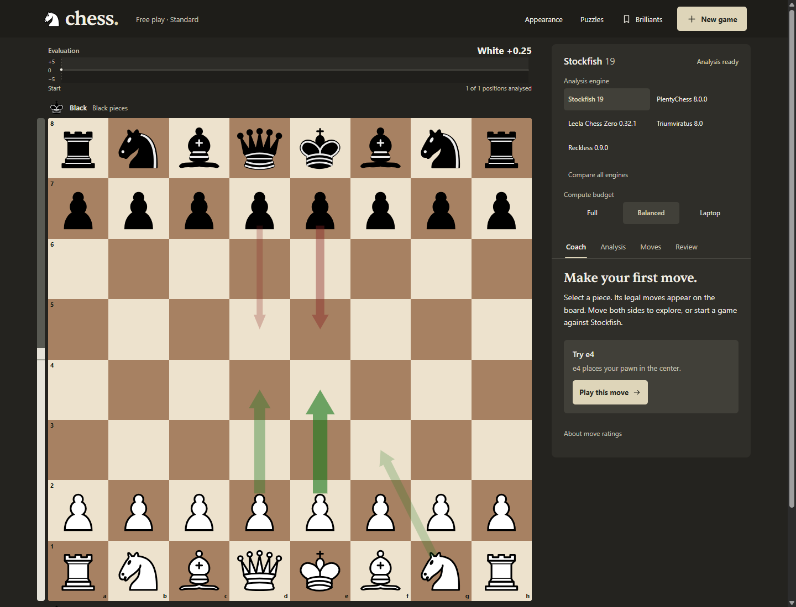

# Chess Play & Fun

**Compare five engines on the same board. Understand your next move.**

A local chess workbench for Windows. Play Standard or Chess960, compare engine moves, solve puzzles, and review mistakes with explanations and retry drills. Candidate moves appear while the engines search on your computer. Optional Lichess features stay off until you enable them.

[](https://github.com/Ekka-Barber/Chess-Play-Fun/actions/workflows/ci.yml)


[](LICENSE)



[Install](#run-locally) · [Use the board](#use-the-board) · [Puzzles](#solve-puzzles) · [Engine guide](#choose-your-engine) · [Performance](#measured-performance) · [Changelog](CHANGELOG.md) · [Releases](https://github.com/Ekka-Barber/Chess-Play-Fun/releases)

## Latest changes

These changes are available on `main`; the latest tagged release is [v4.0.2](https://github.com/Ekka-Barber/Chess-Play-Fun/releases/tag/v4.0.2).

- **Choose directly.** All ten configuration dropdowns have been replaced with visible choices. Select engines and compute budgets beside the board; open Appearance for six board themes and five piece sets.
- **Keep the board large.** The desktop evaluation chart spans its width without reducing the board size. It includes the current score, a ±5-pawn scale, subtle White/Black shading, and a position marker. Unanalysed positions remain gaps. Phones and short landscape screens keep the chart in Analysis.
- **Solve and return.** Four local starter puzzles work offline, with optional Lichess daily puzzles. Squares stay equal, pieces keep their proportions, and refreshing restores this tab's puzzle and progress.
- **Recognise a Brilliant.** Confirmed player moves receive a brief, one-shot impact and ray burst. Appearance includes a preview; reduced motion retains the static marker. No extra engine search is needed.
- **Compare five engines.** Triumviratus and Reckless join Stockfish, PlentyChess, and Leela Chess Zero. Start or stop a comparison from the engine panel.

Verified with **128 passing tests**, plus Chromium gameplay, puzzle, refresh, and desktop/phone layout checks. [Read the changelog](CHANGELOG.md) for the complete fixes and release history.

## Run locally

Use Windows x64 and a CPU with AVX2/BMI2 support for the supplied engine builds. Node.js 24 was used for the local audit. Node 20.x from 20.19 and Node 22.x from 22.12 also provide the [synchronous ESM loading](https://nodejs.org/api/modules.html#loading-ecmascript-modules-using-require) this app uses.

```powershell
git clone https://github.com/Ekka-Barber/Chess-Play-Fun.git
cd Chess-Play-Fun
npm ci
npm run setup:engines
npm start
```

Open **[localhost:4655](http://localhost:4655/)**. Keep the terminal open while playing; press `Ctrl+C` to stop the server.

`setup:engines` downloads pinned official releases. It installs Leela's Windows CPU build (DNNL) with its neural network and runtime DLLs. Run it again after updating to this lineup or to repair missing files, then restart the app. Engine binaries are downloaded separately.

After setup, you can also double-click **`START-CHESS.bat`**. The launcher installs missing Node dependencies and starts the app. Engine downloads remain a separate setup step.

**Save before stopping:** the live game stays in server memory. Export its PGN before restarting. Saved Brilliant-move collections are written to disk.

<details>
<summary>Something did not start?</summary>

| Symptom | What to do |
| --- | --- |
| `node` or `npm` is not recognised | Install a supported Node.js version, reopen the terminal, then retry. |
| Engine download fails | Run `npm run setup:engines` again. Download URLs and target paths are in [the setup script](scripts/setup-engines.js). |
| Only Stockfish appears | The registry skips executables missing from disk. Complete the engine setup, then restart the server. |
| An engine cannot launch on this CPU | Use an upstream build compatible with your instruction set and update its path in [engines.json](engines.json). |
| Engine becomes unavailable during play | Use **Retry engine**. If it fails again, check the executable and restart the server after exporting your PGN. |
| Port 4655 is already occupied | Use the running instance, or set another port: `$env:PORT=4660; npm start`. |
| An old Node version reports an ESM loading error | Use Node.js 24, or the supported 20.x/22.x versions listed above. |

</details>

## Use the board

### Play at your level

Open **New game** to choose Standard or Chess960, your side, an optional clock, and a playing mode.

- **Play both sides.** Move freely to study a position. You can hand White or Black to the selected engine.
- **Play against an engine.** Strength steps from 10% to 90% use Stockfish's Elo limiter, covering 1320 to 2800. At 100%, the engine has no rating cap; search time is still bounded.
- **Try different replies.** Optional **Random top-5** chooses among leading candidates. Forced mates take priority. If the engine's evaluation falls to -3 pawns or worse, survival mode selects its best move until it recovers above -1.5.

Engine moves commit when the search finishes. There is no extra random pause afterward.

Clocks are optional: 3+2, 5+0, 10+0, or custom minutes and Fischer increment. A takeback restores the clock snapshot for that position. Clocks belong to the current tab and disappear on reload.

### Ask one engine or compare all installed engines

The **Arrows** button cycles through **Off → Best → Engines**.

| Mode | What appears |
| --- | --- |
| **Best** | Three candidate moves in a green ranking: stronger lines are darker and wider. Slim red arrows show the opponent's ideas if you pass. |
| **Engines** | Each installed engine's first choice in its own colour. Agreeing engines occupy separate lanes instead of covering one another. The band below the board identifies each engine and evaluation. |

Click **Compare all engines** below the engine choices to start comparison. Click it again to stop. Open the **Analysis** tab for each engine's move, evaluation, and depth. Hover or focus a row to isolate its arrow.

Comparison requests use a 300 ms budget per engine and search one engine at a time. Initialization can overlap. A playing engine's reply gets priority over analysis work.

**Analysis** explains the last move and adds a short note to each engine line. The built-in position guide includes plans for selected Caro-Kann, Italian, Queen’s Gambit Declined, and Nimzo-Indian positions. It recognizes the same opening position across move orders. Beyond the written plans, the guide uses legal moves, the existing Coach assessment, and the selected engine's current lines.

<details>
<summary>See ranked analysis without the engine-vote overlay</summary>


</details>

### Learn from the moves you played

The **Coach** grades moves from Brilliant and Great through Inaccuracy, Mistake, and Blunder. It explains the assessment, shows the better continuation, and identifies the opening when the move sequence is in the built-in book.

Open **Review** for side-by-side accuracy, the winning-chances graph, and key moments. **Retry** returns you to a mistake and judges an alternative without changing the game. An answer passes if it is the best move, delivers mate, or stays within five percentage points of the best move's expected outcome.

**Deep review** uses a separate engine process with a depth-20 target and a 20-second cap per position. You can browse the board while it runs. Move labels use this app's own grading heuristics and can change as analysis deepens.

### Keep your Brilliant moves

A verified player sacrifice classified as Brilliant is automatically saved under `Brilliant Moves/` with:

- A 1024 × 1240 board image.
- The game PGN.
- Metadata, the explanation, and the position before the move.

Open **Brilliants** to download an image or PGN, or use **Study** to restore the saved game. Engine moves are not collected as the player's finds.

## Choose your engine

The registry records the installed binaries' capabilities. The selected engine handles the roles it supports; the UI explains any Stockfish fallback.

| Engine | Chess960 | Multiple candidate lines | Elo limiter | Role in this app |
| --- | :---: | :---: | :---: | --- |
| [Stockfish 19](https://github.com/official-stockfish/Stockfish) | Yes | Yes | Yes | Default engine; calibrated opponents and fallback coaching. |
| [PlentyChess 8.0.0](https://github.com/Yoshie2000/PlentyChess) | Yes | Yes | No | Standard and Chess960 play, analysis, and comparison votes. |
| [Leela Chess Zero 0.32.1](https://github.com/LeelaChessZero/lc0/releases/tag/v0.32.1) | Yes | Yes | No | Full-strength play, analysis, and comparison votes in Standard and Chess960. |
| [Triumviratus 8.0](https://github.com/Tors3/Triumviratus/releases/tag/v8.0) | Yes | Yes | No | Full-strength play, analysis, and comparison votes in Standard and Chess960. |
| [Reckless 0.9.0](https://github.com/codedeliveryservice/Reckless/releases/tag/v0.9.0) | Yes | Yes | No | Full-strength play, analysis, and comparison votes in Standard and Chess960. |

At 10–90% strength, Stockfish plays if the chosen engine has no Elo limiter.

Download versions are pinned in [the setup script](scripts/setup-engines.js). Paths and capability flags live in [engines.json](engines.json).

## Measured performance

The November 2026 audit used the earlier five-engine lineup. It measured these paths before and after the responsiveness fixes.

| Task | Before | After |
| --- | ---: | ---: |
| Completed next-position analysis after two rapid off-book moves | 3.22 s | 1.61-1.63 s |
| Five-engine comparison with newly started engine processes | 2.60 s | 1.59-1.70 s |
| Browser update interval while work is active | 700 ms | 200 ms |

These are local measurements in Balanced mode with two engine threads. Position, CPU load, startup state, and engine caches affect timing. They are not promises for every machine.

Suggestions now stream during search, before historical grading completes. An early preview can be shallow; only completed searches enter the cache used for grading, hints, and retry judging. The configured search budgets and rating limits were preserved.

[Read the full audit](AUDIT-V4.md) for the measurement conditions, individual engine timings, regression cases, and verification limits.

### Keep chess work within a budget

Live analysis, engine votes, and playing replies share **one interactive search slot**. Game replies get priority. Deep review has its own process and lower scheduling priority.

| Power mode | Analysis threads | Playing threads | Deep-review threads | Deep-review priority |
| --- | ---: | ---: | ---: | --- |
| Full | 3 | 2 | 3 | Below normal |
| Balanced, default | 2 | 2 | 2 | Idle |
| Laptop | 1 | 1 | 1 | Idle |

Analysis and playing thread counts are alternate users of the shared slot, not concurrent interactive searches. The comparison engines use the analysis budget.

Idle engines quit after five minutes and restart on demand. Live analysis pauses when every tracked tab is hidden; a visible tab keeps it active. Existing polls renew tab visibility, and closed or expired tabs do not keep a visible board paused. Playing replies and deep review continue independently of that visibility pause.

## Optional online lookups

In **Analysis**, enable **Lichess lookups** for these optional features:

| Service | What it provides | Local cache |
| --- | --- | --- |
| Tablebase | Exact endgame results for positions with seven pieces or fewer, including DTZ/DTM when available. | Stored without expiry. |
| Cloud evaluation | A stored evaluation and principal variation for the current position, when Lichess has one. | 24 hours. |
| Daily puzzle | A validated puzzle fetched only when you click **Load Lichess daily** in Puzzles. | Reused for the same UTC day; upstream retry delays are respected. |

For tablebase and cloud requests, the server checks that the FEN belongs to the game before sending it upstream. Tablebase piece counting happens locally. Position caches live under `.cache/online/`; daily puzzles use `.cache/puzzles/`. Upstream failures return a readable status in the app.

With lookups off, play, local analysis, and the four starter puzzles work without those services. Initial dependency and engine downloads still require an internet connection.

## Controls

Use drag and drop, click a piece then its destination, or navigate by keyboard. Selecting a piece shows legal destinations. In Chess960, castle by moving the king onto its rook.

| Key | Action |
| --- | --- |
| Arrow keys while the board has focus | Move between squares. |
| `Enter` / `Space` | Select a piece or play to the focused destination. |
| `Esc` | Cancel selection. |
| `←` / `→` outside the board | Browse previous/next positions. |
| `Home` / `End` | First/latest position. |
| `F` | Flip the board. |

Configuration uses visible choices throughout. **Appearance** offers six board themes and five piece sets: Cburnett, Merida, Chessnut, Fantasy, and RhosGFX. Both choices are remembered in your browser. Board squares have labels and visible focus states, and the interface supports reduced motion and phone layouts.

A confirmed player Brilliant gets a brief badge impact and ray burst, once per move while this page is open. The effect does not request more engine analysis. **Appearance → Preview brilliant** demonstrates it; reduced-motion preferences retain the static marker.

### Solve puzzles

Open **Puzzles** for three original mate-in-one exercises and a longer combination from [Lichess's public API example](https://github.com/lichess-org/api/blob/master/doc/specs/examples/puzzles-getDailyPuzzle.json.yaml). These four starters use the local server and need no internet connection. **Load Lichess daily** fetches a puzzle only when requested and requires **Lichess lookups** to be enabled in Analysis.

Correct moves include the opponent's reply. Hints, solution reveal, retry, and next-puzzle controls are available. A result completed after a hint is labelled as assisted. Refreshing keeps this tab's puzzle, accepted moves, hint or revealed solution, and completion state. Browser Back returns between puzzles and the game. A new game or restored collection entry returns to the game view.

Puzzle progress is separate from the shared game and stored in this tab's session storage. An active game clock continues running. Daily attempts loaded before a server restart may need to be loaded again; the server validates moves against puzzles known to its current process.

## Know the limits

- **One shared game per server process.** Tabs share the board and session settings. The app is a local workbench, not a multiplayer server.
- **Live games are not persisted.** Restarting clears the current game. Export PGN before stopping; saved Brilliant collections remain on disk.
- **Clocks are tab-local.** Reloading loses the current clock, even while the server's game continues.
- **Windows engine setup.** Other operating systems and instruction sets need compatible upstream binaries and configuration. They are not packaged by the setup script.
- **Time-bounded judgments.** A depth target may hit its time cap, and deeper analysis can change a move's grade.
- **PGN export is available; PGN import is not implemented.** Online opponent play and automatic game imports are also outside the current app.
- **Accessibility checks have limits.** Automated checks and keyboard testing ran in Chromium; a full screen-reader and physical-touch audit has not been completed.

## Development and verification

Vanilla JavaScript, Express, [chessops](https://github.com/niklasf/chessops), and native UCI processes. No frontend build step.

```powershell
npm ci
npm test
```

The local audit passed **128 tests**. Tests stub the engine boundary and run without downloading the binaries; the alternate-engine switch case skips when no second engine is installed. [GitHub Actions](https://github.com/Ekka-Barber/Chess-Play-Fun/actions/workflows/ci.yml) runs the suite on Node 20 and 22. The Chromium harness also accepts a debugging port and an explicit disposable app URL: `node test/browser.cjs <debug-port> http://127.0.0.1:4660/`. It replaces that server's game while testing.

Coverage includes legal moves and Chess960 castling, stale requests, engine fallback and switching, progressive analysis, exclusive search scheduling, tab visibility, clocks, move grading, retry judging, archive writes, online opt-in, legal puzzle lines and daily-puzzle validation, evaluation-chart gaps and retry privacy, arrow geometry, and contrast rules.

The same audit exercised the earlier lineup at 100% strength, engine-vote cycling, history controls, and six themes at desktop and narrow widths. It recorded zero automated Axe violations in the checked state.

### Find the code

| Path | Responsibility |
| --- | --- |
| [server.js](server.js) | Game state, routes, analysis scheduling, engine comparison, and review. |
| [lib/engine.js](lib/engine.js) | UCI transport, progressive results, process lifecycle, and priority. |
| [lib/governor.js](lib/governor.js) | Power budgets and the shared interactive search slot. |
| [lib/rules.js](lib/rules.js) | Legal moves, SAN, PGN, and Chess960 through chessops. |
| [lib/tutor.js](lib/tutor.js) | Move grading, hints, and sacrifice assessment. |
| [lib/archive.js](lib/archive.js) | Brilliant-move images, PGN, metadata, and collection storage. |
| [lib/online.js](lib/online.js) | Opt-in Lichess requests and disk caching. |
| [lib/puzzles.js](lib/puzzles.js) | Starter and daily puzzles, legal solution validation, hints, and daily caching. |
| [public/](public/) | Board UI, themes, clocks, review tools, and piece assets. |
| [scripts/](scripts/) | Engine setup and screenshot capture tools. |
| [test/](test/) | Regression suite. |

For a bug report, include the selected engine, variant, power mode, Node version, and the move sequence or exported PGN. [Open an issue](https://github.com/Ekka-Barber/Chess-Play-Fun/issues).

## Credits and licenses

The application code uses the [MIT license](LICENSE). Downloaded engines have their own upstream licenses; review the projects linked in the engine table before redistributing binaries.

The app uses [chessops](https://github.com/niklasf/chessops), [Express](https://expressjs.com/), [resvg-js](https://github.com/yisibl/resvg-js), [five attributed chess-piece sets](public/pieces/README.md), and the self-hosted [Sentient typeface](public/fonts/LICENSE.txt). Its accuracy calculations follow the published Lichess approach; its move classifications are local heuristics.

README screenshots show the running application with real engine results. Optional poster artwork in `assets/` was generated with GPT Image 2.5 via Higgsfield and is separate from the app interface.
